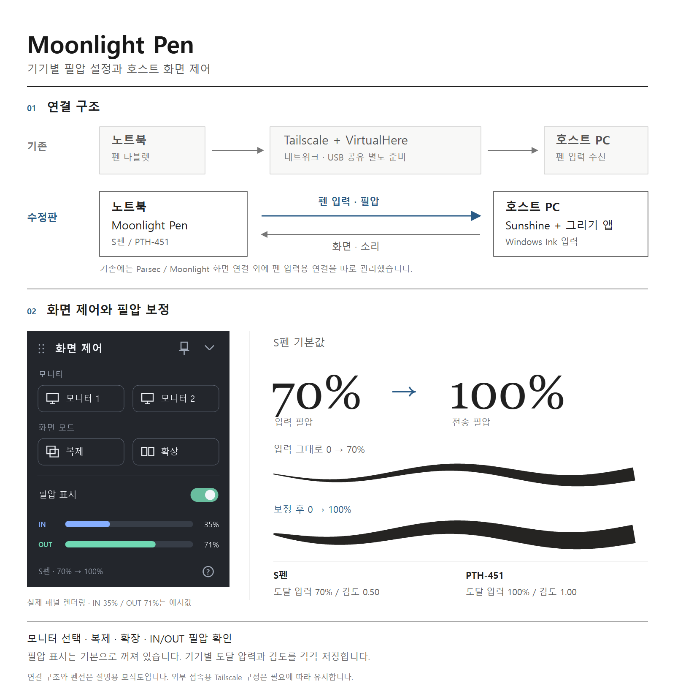

# Moonlight Pen

**노트북의 S펜 또는 PTH-451로 데스크톱 PC에 그림을 그리기 위한 Windows용 Moonlight 수정판입니다.**
기기별 필압 보정·화면 제어·양방향 텍스트 클립보드를 함께 제공합니다. Moonlight 공식 배포판은 아닙니다.

## 다운로드와 설치

**노트북에는 01, 호스트 PC에는 02를 설치하세요.** 손터치 단축키가 필요하면 노트북에 03을 추가합니다. 현재 배포판은 **v2026.11.16-clipboard-r4**입니다.

| 기능 | 최신 소스 (`main`) | 아래 실행용 ZIP |
| --- | --- | --- |
| S펜·PTH-451 필압 보정 / IN·OUT 표시 | 포함 | 01 문라이트에 포함 |
| 모니터 선택 / 호스트 복제·확장 | 포함 | 01 문라이트 + 02 호스트 화면 전환 |
| 양방향 텍스트 클립보드 · UTF-8 16MiB | 클라이언트 코드와 Sunshine 패치 포함 | **01 문라이트 + 02 호스트 도구에 포함** |
| 손터치 전환 `Ctrl+Alt+F10` | 별도 도구 소스 포함 | 03 손터치 도구를 별도 설치 |
| 포맷 후 통합 복원 | 복원 도구 소스 포함 | 개인 설정을 담은 완성 복원 ZIP은 공개하지 않음 |

**기존 클립보드 r3에서 업데이트할 때는 노트북 01과 호스트 02를 모두 업데이트하세요.** 설정을 유지하는 방법은 [기존 설치 업데이트](#기존-설치-업데이트)를 참고하세요. 02는 **Sunshine 2026.914.233613 Windows AMD64**의 검증된 공식 설치본과 이전 클립보드 패치를 지원하며, 다른 버전을 자동으로 덮어쓰지 않습니다.

### [⬇ 01 · 노트북용 문라이트 ZIP 바로 다운로드 · 약 44MB](https://github.com/wow2658/moonlight-pen/releases/latest/download/01-Laptop-Moonlight-Pen.zip)

**펜을 사용하는 노트북에서 받으세요.** 전체 압축 해제 후 `문라이트 실행.cmd`를 실행합니다.

### [⬇ 02 · 호스트용 클립보드·화면 전환 ZIP 바로 다운로드 · 약 34MB](https://github.com/wow2658/moonlight-pen/releases/latest/download/02-Host-Moonlight-Tools.zip)

**Sunshine과 그리기 앱이 설치된 데스크톱 PC에서 받으세요.** 스트리밍 연결을 끊고 전체 압축 해제 후 `호스트 설치.cmd`를 실행합니다. 관리자 권한 요청을 승인하면 **클립보드 패치와 복제·확장 바로가기**를 함께 설치합니다. Sunshine 설정과 페어링은 유지합니다.

### [⬇ 선택: 손터치 F10 도구 ZIP 바로 다운로드 · 약 176KB](https://github.com/wow2658/moonlight-pen/releases/latest/download/03-Laptop-Finger-Touch.zip)

**Samsung 940X3M 노트북 전용입니다.** 손가락 터치스크린만 **Ctrl+Alt+F10**으로 켜고 끄며 S펜은 유지합니다. Moonlight 연결 없이도 작동합니다. 전체 압축 해제 후 **`CHECK.cmd` → `INSTALL.cmd`** 순서로 실행하세요. 이미 잘 쓰고 있다면 재설치할 필요는 없습니다.

개인 장치 ID는 포함하지 않고 현재 PC에서 모델·손터치·별도 S펜을 확인합니다. 다른 모델이나 모호한 장치 구성이면 중단합니다. 관리자 권한이 필요하며 자체 빌드라 코드 서명이 없습니다. [설치·검증 범위](touch-toggle/README.md) · [보안 검토](docs/TOUCH_SECURITY.md) · [ZIP SHA256](https://github.com/wow2658/moonlight-pen/releases/latest/download/SHA256SUMS.txt)

위 링크를 누르면 ZIP을 바로 다운로드합니다. Releases 페이지에서 파일을 따로 찾을 필요는 없습니다.

소스와 실행용 ZIP은 GitHub 로그인 없이 열고 다운로드할 수 있습니다.

각 ZIP을 푼 폴더에서 아래 파일을 실행하세요.

| 다운로드 | 사용할 PC | 실행 / 설치 | 삭제 |
| --- | --- | --- | --- |
| 01 · 문라이트 | 노트북 | `문라이트 실행.cmd` | `삭제.cmd` |
| 02 · 호스트 도구 | 호스트 PC | `호스트 설치.cmd` | `삭제.cmd` |
| 03 · 손터치 도구 — 선택 | 940X3M 노트북 | `CHECK.cmd` → `INSTALL.cmd` | `삭제.cmd` |

**GitHub의 초록색 `Code → Download ZIP`과 Releases의 `Source code`는 개발용 소스입니다. 실행하려면 위의 기능별 ZIP을 받으세요.**

**설치한 ZIP과 삭제 파일이 1:1로 대응합니다.** 01은 문라이트·저장 설정·해당 방화벽 규칙/바로가기를 지웁니다. 02는 **클립보드 패치를 공식 원본 Sunshine으로 되돌리고 화면 전환 바로가기를 제거**하며, Sunshine 자체와 설정·페어링은 보존합니다. 03은 손터치를 켠 뒤 F10 프로그램·자동 실행·바로가기·로그를 지웁니다.

이미 지금 구성으로 잘 쓰고 있다면 재설치할 필요는 없습니다. 아래 안내는 새 PC에 설치하거나 나중에 복구할 때 사용하세요.

## 기존 설치 업데이트

1. **노트북:** 문라이트를 완전히 종료하고 새 01 ZIP을 기존 `01-Laptop-Moonlight-Pen` 폴더에 덮어씁니다. `문라이트 실행.cmd`와 `app`이 기존 파일과 같은 위치에 오도록 하세요. 기존 `app/Moonlight Game Streaming Project` 설정 폴더는 지우지 않습니다. 업데이트 전에 `삭제.cmd`를 실행하면 설정·페어링까지 지워지므로 실행하지 마세요.
2. **호스트:** 스트리밍 연결을 끊고 새 02 ZIP을 압축 해제한 뒤 `호스트 설치.cmd`를 실행합니다. 이전 클립보드 패치를 인식해 업데이트하며 검증된 공식 원본 백업은 유지합니다.
3. **다시 연결:** 노트북에서 호스트 타일 메뉴의 **텍스트 클립보드 공유**를 켜고 연결합니다. 새로운 긴 텍스트를 복사해 양방향으로 붙여넣어 확인하세요. 이번 16MiB 한도는 양쪽 모두 r4일 때 지원합니다.

설정이 없는 새 폴더에 01을 풀었다면 새 설치로 시작하므로 다시 페어링해야 합니다. 예전 `Moonlight-Clipboard-Test` 구성은 `01-Laptop/app`이 실제 실행 폴더입니다. 기존 `app`을 보존하고 새 01의 `app` 내용을 같은 위치에 덮어쓴 뒤 기존 실행기를 사용하면 됩니다.

## 개발 배경

노트북의 S펜과 PTH-451로 호스트 PC의 그리기 프로그램을 사용하기 위해 시작한 수정판입니다.

기존에 사용하던 Parsec·Moonlight 구성에서는 원하는 필압 전달이 되지 않아 Tailscale과 VirtualHere를 함께 사용했습니다. 이 방식은 화면 연결과 별도로 네트워크·USB 공유를 설정하고 관리해야 해 사용 과정이 복잡했습니다.

이러한 준비 과정을 줄이기 위해 Moonlight의 펜 입력 전달 기능을 활용하고, 기기별 필압 보정과 화면 제어 기능을 추가했습니다.

패널은 현재 코드로 렌더링한 UI이며 IN 35% / OUT 71%는 예시값입니다. 연결 구조와 펜선은 설명용 모식도입니다.

## 1. 데스크톱 PC에서 준비하기 — 처음 한 번

여기서 **호스트**란 화면을 보내 주는 PC, 즉 그리기 프로그램이 설치된 데스크톱을 뜻합니다.

1. Sunshine의 버전을 확인합니다. 텍스트 클립보드 패치는 **2026.914.233613 Windows AMD64**에 맞춰져 있습니다. 새 PC라면 공식 [해당 버전 MSI](https://github.com/SunshineStream/Sunshine/releases/download/v2026.914.233613/Sunshine-Windows-AMD64-installer.msi)를 설치하고 **Sunshine의 로컬 관리 계정**을 만듭니다. 이미 다른 버전을 쓰고 있다면 자동으로 덮어쓰거나 버전 검사를 우회하지 마세요. ARM64·lite와 다른 빌드의 지원 범위는 [호스트 패치 안내](host-clipboard/README.md)를 확인하세요.
2. `02-Host-Moonlight-Tools.zip`을 **데스크톱 PC에** 다운로드합니다.
3. ZIP을 오른쪽 클릭해 **모두 압축 풀기**를 선택합니다. ZIP 안에서 바로 실행하지 마세요.
4. 스트리밍 연결을 끊고 풀린 폴더에서 `호스트 설치.cmd`를 더블클릭합니다. 관리자 권한 요청을 승인합니다.
5. 검은 창에 `PASS: r4 clipboard and screen shortcuts installed.`가 나오면 설치가 끝났습니다. 기존 Sunshine 설정·페어링은 유지하며 서비스가 잠시 재시작됩니다.

펜 필압만 사용할 때는 호스트 패치가 필요 없습니다. 기존 화면 전환만 필요한 사용자를 위해 [화면 전환 전용 ZIP](https://github.com/wow2658/moonlight-pen/releases/latest/download/02-Host-Display-Shortcuts.zip)도 유지합니다. 이 작은 전용 ZIP에는 클립보드가 없습니다. 위의 기본 02 다운로드는 두 기능을 함께 설치합니다.

## 2. 노트북에서 문라이트 실행하기

1. `01-Laptop-Moonlight-Pen.zip`을 **노트북에** 다운로드합니다.
2. **모두 압축 풀기**를 누르고, 풀린 폴더를 문서 등 계속 보관할 위치에 둡니다.
3. 기존 Moonlight를 종료한 뒤 `문라이트 실행.cmd`를 더블클릭합니다.
4. 문라이트에 데스크톱 PC가 나타나면 선택합니다. 안 보이면 `+`로 호스트의 IP를 입력합니다.
5. 처음 연결하면 문라이트가 보여 주는 **PIN을 호스트 PC의 Sunshine 웹 화면 → PIN에 입력**해 페어링합니다. 이 단계는 두 기기를 서로 연결하는 절차입니다.
6. 문라이트에서 **Desktop**을 실행합니다. 노트북에 데스크톱 화면이 보이면 연결 성공입니다.

`문라이트 실행.cmd`와 `app` 폴더는 함께 두세요. 바탕화면에서 실행하고 싶다면 CMD 파일의 **바로가기**를 만드세요. CMD나 EXE 파일 하나만 따로 옮기면 실행되지 않습니다.

이 패키지는 빈 설정으로 시작합니다. 이전 PC의 인증서나 개인 설정은 들어 있지 않으므로, 새 설치에서는 직접 페어링해야 합니다.

## 3. 펜과 화면 버튼이 되는지 확인하기

| 확인할 것 | 어디서, 무엇을 하나요? | 정상 결과 |
| --- | --- | --- |
| 필압 | 연결된 호스트에서 그리기 앱을 열고 약하게/강하게 선을 그립니다. | 브러시 굵기나 진하기가 달라집니다. |
| 입력·전송 막대 | 연결 중 `Ctrl+Alt+Shift+P`를 누르고 펜을 눌러 봅니다. | **IN / OUT 두 막대**가 움직입니다. 다시 누르면 숨겨집니다. |
| 화면 패널 | 연결 중 `Ctrl+Alt+Shift+B`를 누릅니다. | 모니터·복제·확장 버튼이 보입니다. |
| 호스트 연결 확인 | 패널의 `?`를 누릅니다. | **호스트 PC의 Windows 디스플레이 설정**이 열립니다. |
| 복제·확장 | 패널에서 **복제** 또는 **확장**을 누릅니다. | **호스트 PC**의 화면 모드가 바뀝니다. 노트북 화면 모드를 바꾸는 버튼이 아닙니다. |

새 설치에서는 필압 막대와 오른쪽 아래 화면 버튼이 기본으로 꺼져 있습니다. **B를 누르면 패널이 열리고 다시 누르면 버튼·필압 막대까지 완전히 숨겨집니다.** 숨겨도 필압 보정은 계속 적용됩니다. 기존 설치에 저장된 표시 설정은 유지합니다. IN/OUT 막대가 움직이는 것은 노트북의 입력·전송 값을 확인한 것이며, 그리기 앱의 필압 동작은 직접 선을 그려 확인합니다.

**PTH-451은 노트북에 연결합니다.** [Wacom 공식 드라이버](https://www.wacom.com/support/product-support/drivers)에서 모델 **PTH-451**을 검색해 지원되는 Windows 드라이버를 노트북에 설치하고, **와콤 타블렛 등록정보 → 펜 → 매핑 → Windows Ink 사용**을 켜세요. 호스트의 그리기 앱도 Windows Ink/태블릿 PC 입력을 사용하도록 설정합니다. [Wacom PTH-451 공식 설명서](https://101.wacom.com/UserHelpPDF_Legacy/PTH-451_en.pdf)

## 필압을 내 손에 맞추기

문라이트 연결을 끊고 **설정(톱니바퀴) → 펜 필압 설정**을 엽니다. 바꾼 값은 **다음 연결부터** 적용됩니다.

| 항목 | 기본값 / 사용법 |
| --- | --- |
| 사용할 필압 설정 | **자동**. 내장 펜은 S펜, 외장 타블렛은 PTH-451. 잘못 선택되면 직접 지정합니다. |
| S펜 · 100%에 도달하는 입력 압력 | **70%**. 펜을 최대 힘의 70%까지 누르면 전송 필압이 100%가 됩니다. |
| PTH-451 · 100%에 도달하는 입력 압력 | **100%**. 필요하면 20~100% 사이에서 조절합니다. |
| 중간 필압 감도 | 왼쪽으로: 더 부드럽게. **1.00**: 직선 비례. 오른쪽으로: 더 단단하게. |
| 필압 기본값 복원 | S펜 70% / 감도 0.50, PTH-451 100% / 감도 1.00, 필압 표시 꺼짐으로 되돌립니다. |

## 평소에 기억할 단축키

모두 **노트북에서** 누릅니다. 손터치 전환은 별도 프로그램이 처리하며, 나머지는 Moonlight 스트리밍 연결 중 사용합니다.

| 단축키 | 기능 | 사용 범위 |
| --- | --- | --- |
| **`Ctrl+Alt+F10`** | **손가락 터치스크린 켜기 / 끄기 · S펜 유지** | 손터치 도구 설치 후 노트북 전체에서 사용. Moonlight 연결 불필요 |
| `Ctrl+Alt+Shift+B` | 화면 패널 열기 / 버튼까지 완전히 숨기기 | Moonlight 스트리밍 중 |
| `Ctrl+Alt+Shift+P` | 필압 IN/OUT 표시 켜기 / 끄기 | Moonlight 스트리밍 중 |
| `Ctrl+Alt+Shift+O` | 성능 통계 표시 켜기 / 끄기 — 이 수정판은 S 대신 **O** | Moonlight 스트리밍 중 |
| `Ctrl+Alt+Shift+K` | Windows 키 등 시스템 키를 호스트로 전달할지 전환 | Moonlight 스트리밍 중 |
| `Ctrl+Alt+Shift+1` / `2` | 호스트 모니터 1 / 2 전환 요청 | Moonlight 스트리밍 중 |

**F10은 선택 다운로드인 `03-Laptop-Finger-Touch.zip`을 설치하면 사용할 수 있습니다.** 기존 01 문라이트 ZIP에는 포함되지 않습니다. 다운로드판은 개인 프로필 없이 현재 장치를 확인하며 940X3M만 지원합니다. [설치 설명과 제한](touch-toggle/README.md)을 확인하세요.

패널의 **모니터 1 / 2**는 스트리밍할 화면 선택입니다. Sunshine이 나열하는 순서라 Windows 설정의 화면 번호와 다를 수 있습니다.

## 텍스트 클립보드

최신 소스의 문라이트에는 기존 필압·화면 제어 기능과 호스트별 텍스트 클립보드 공유가 함께 들어 있습니다. 한글·이모지를 양방향으로 전달하며, 같은 텍스트를 반복 전송하거나 덮어쓰지 않도록 처리합니다. 이미지·파일 전송은 포함하지 않습니다.

텍스트 한도는 **UTF-8 기준 16MiB**입니다. 이전 클립보드 테스트판의 1MiB에서 늘렸으며, 새 한도를 쓰려면 **클라이언트와 호스트 패치를 함께 업데이트**해야 합니다. 글자 수와 바이트 수는 다릅니다. 한글은 보통 한 글자에 3바이트, 이모지는 4바이트 이상이어서 같은 글자 수라도 크기가 달라집니다.

**현재 공개 다운로드 01과 02에 포함되어 있습니다.** 필요한 구성은 다음과 같습니다.

1. **노트북:** 위의 **01 문라이트 ZIP**을 설치합니다. 직접 소스를 수정할 때만 [Windows 빌드 안내](BUILDING.md)가 필요합니다.
2. **호스트 PC:** 위의 **02 호스트용 클립보드·화면 전환 ZIP**을 설치합니다. 기반 버전은 **Sunshine 2026.914.233613**입니다. [호스트 패치·설치기·검증 범위](host-clipboard/README.md)를 확인하세요.
3. **공유 켜기:** Moonlight의 호스트 타일 메뉴에서 **텍스트 클립보드 공유**를 켠 뒤 연결합니다. 공유 여부는 호스트별로 저장합니다.
4. **확인:** 노트북에서 새 텍스트를 복사해 호스트에 붙여넣고, 반대 방향도 확인합니다. 한글·이모지와 Win+V 목록의 반복 갱신 여부도 함께 확인하세요.

기존 테스트판은 [기존 설치 업데이트](#기존-설치-업데이트) 순서로 올릴 수 있습니다. 이전 버전의 실제 양방향 텍스트 전송은 사용자 확인을 받았습니다. 이번 16MiB 변경은 격리된 Windows 클립보드에서 긴 한글·이모지와 최대 크기 양방향 테스트를 통과했으며, **r4로 두 PC를 연결한 실제 긴 텍스트 전달은 사용자 확인 전**입니다. [호스트 문서](host-clipboard/README.md)에 검증 범위를 구분했습니다.

## 포맷 후 복원과 손터치

[통합 복원 도구](restore-kit/README.md)는 노트북 필압/UI 설정·텍스트 클립보드·호스트 화면 전환·손터치 단축키를 복원하는 소스 템플릿입니다. 실행 파일과 개인 설정은 Git 밖에서 조립합니다. 포맷 전 호스트에서 설정 백업을 생성해 완성 묶음과 함께 보관하며, 계정 비밀번호·인증서·페어링 키는 옮기지 않습니다.

노트북 전체의 손터치는 **Ctrl+Alt+F10**으로 켜고 끄며 S펜은 유지합니다. Moonlight와 독립적으로 작동하는 별도 프로그램입니다. 공개 **03 손터치 도구**는 개인 장치 ID 없이 현재 PC의 장치를 확인합니다. 개인 프로필을 사용하는 기존 복원 구성은 포맷 후 장치 ID를 다시 확인해야 합니다. [손터치 도구의 지원 범위와 설치 안내](touch-toggle/README.md)를 참고하세요.

Windows 키·Win+V가 어느 PC에 적용되는지는 **Ctrl+Alt+Shift+K**의 시스템 키 캡처 상태와 관련 있습니다. [단축키 전체와 적용 범위](restore-kit/단축키%20모음.md)에 화면 패널·모니터·필압·성능·손터치 키와 충돌을 정리했습니다. 노트북에서는 **B 패널의 복제/확장 버튼**을 사용하세요. 호스트용 D/E/H를 노트북에서 직접 누르면 Moonlight의 최소화/종료 단축키와 충돌할 수 있습니다.

## 막히면 / 나중에 다시 꺼내 볼 때

- **[문제 해결과 재설치 안내](docs/TROUBLESHOOTING.md)** — 창이 안 뜸, 필압 안 됨, 복제·확장 무반응, PC 교체, 설정 보관.
- **[개발자용 빌드 안내](BUILDING.md)** — 소스를 수정하고 직접 EXE를 만들 때만 읽으면 됩니다.
- [변경과 출처](NOTICE.md) · [검사 기록](PUBLICATION_SCAN.md) · [원본 Moonlight 안내](README.upstream.md)

## 라이선스

Moonlight Qt와 이 수정판은 [GNU GPL v3](LICENSE) 조건으로 배포합니다. 실행용 ZIP의 `licenses`와 `SOURCE.txt`에 포함 라이브러리의 고지와 대응 소스 위치를 담았습니다. 의존 소스 출처·리비전은 [SOURCE_ORIGINS.json](SOURCE_ORIGINS.json)에 기록했습니다.
